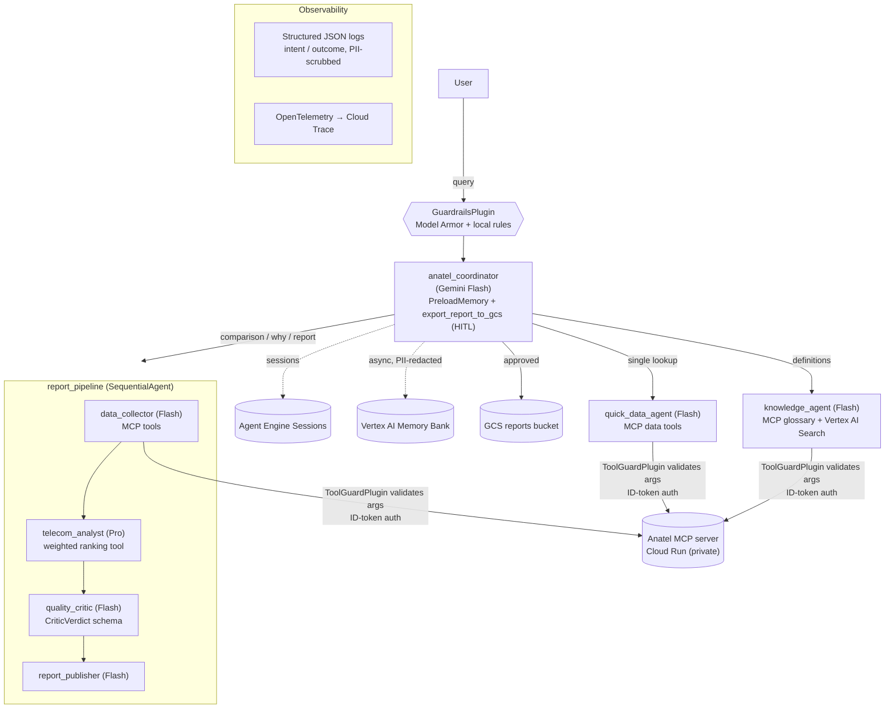

# Anatel Telecom Advisor

**A multi-agent ADK system that turns official Anatel (Brazil's telecom regulator) quality and consumer data into grounded, fact-checked competitive intelligence, deployed on Vertex AI Agent Engine.**

> Track: **Enterprise Agents** · Built with **Google ADK (Python) 2.x**, **Gemini 2.5 Flash/Pro**, **MCP**, **Vertex AI Agent Engine**, **Memory Bank**, **Model Armor**, **Cloud DLP**, **Vertex AI Search**, **Cloud Trace**.

---

## 1. Problem

Anatel publishes rich open data about telecom quality in Brazil, but it is fragmented across **four independent pillars**:

| Pillar | What it measures |
|---|---|
| **RQUAL / IQS** | Quality seal A–E and IQS score 0–10 |
| **Network indicators** | Download/upload compliance, latency, jitter, packet loss, availability |
| **Anatel Consumidor / IDA** | Complaints per 1,000 accesses, main reasons, resolution rate, IDA 0–100 |
| **Satisfaction survey / ISG** | Overall satisfaction 0–10, service and billing scores |

Answering a simple business question like *"How does my company compare with Claro and Vivo in broadband in Ceará, and why are we losing?"* means downloading several CSV/ZIP files, knowing regulatory jargon, aligning filters (service, state, municipality, period) and cross-referencing them by hand. Market analysts at operators and regional ISPs spend hours on this, and consumers simply can't do it.

## 2. Solution

**Anatel Telecom Advisor** is a conversational analyst that:

1. **Retrieves** live data from an existing **Anatel MCP server** (Cloud Run) exposing 7 tools across all 4 pillars.
2. **Analyzes** it with a senior-analyst agent (Gemini Pro), including custom-weighted rankings.
3. **Fact-checks itself**: an independent critic (LLM-as-judge) verifies every number against the tool outputs before anything reaches the user.
4. **Remembers** each user's context (company, region, service) across sessions with Vertex AI Memory Bank.
5. **Publishes** reports to Cloud Storage **only after explicit human approval**.

### User stories

| # | Persona | Story | Example |
|---|---|---|---|
| 1 | Market analyst (operator/ISP) | Compare my operator with competitors in a state to find gaps | "Compare Brisanet, Claro e Vivo em banda larga no CE" |
| 2 | Market analyst | Understand why customers complain, to prioritize actions | "Principais motivos de reclamação da TIM no SMP em SP?" |
| 3 | Market analyst | Rank with **my** strategic weights | "Refaça o ranking dando 60% de peso ao atendimento" |
| 4 | Manager | Save/share the report (with approval) | "Salve o relatório" |
| 5 | Consumer | Find the best provider where I live | "Qual a melhor fibra em Campinas?" |
| 6 | Anyone | Understand regulatory jargon | "O que é o selo RQUAL? E o IDA?" |
| 7 | Returning user | The agent remembers my context | (days later) "E como estamos este mês?" |

---

## 3. Architecture



**Request lifecycle:** `GuardrailsPlugin` screens the prompt → the coordinator routes by intent → specialists call MCP tools (args validated by `ToolGuardPlugin`, every call logged as *intent* then *outcome* by `ObservabilityPlugin`, spans exported to Cloud Trace) → for reports, the critic validates groundedness and the publisher applies fixes → memory is generated in the background → export requires human confirmation.

### Repository layout

```
.
├── anatel_advisor/
│   ├── agent.py              # root_agent + App (plugins, compaction, context cache)
│   ├── sub_agents.py         # knowledge, quick data, report pipeline (collector→analyst→critic→publisher)
│   ├── prompts.py            # constitution + role instructions
│   ├── schemas.py            # Pydantic schemas (MCP args, tool I/O, CriticVerdict)
│   ├── config.py             # env-based settings + model routing table
│   ├── secrets.py            # Secret Manager access
│   ├── memory.py             # RedactingMemoryService + async memory generation
│   ├── runtime.py            # Agent Engine session/memory service builders
│   ├── pii.py                # Cloud DLP / regex PII redaction
│   ├── tools/
│   │   ├── mcp_anatel.py     # McpToolset → private Cloud Run MCP (ID token auth)
│   │   └── report_tools.py   # ranking, filters, HITL export
│   ├── plugins/
│   │   ├── guardrails.py     # Model Armor + prompt-injection rules
│   │   ├── tool_guard.py     # schema validation + guided error recovery
│   │   └── observability.py  # intent vs outcome structured logs
│   └── observability/        # JSON logging + OpenTelemetry/Cloud Trace
├── tests/
│   ├── unit/                 # offline unit tests
│   └── eval/                 # golden dataset + ADK AgentEvaluator
├── infra/setup.sh            # IaC (gcloud): APIs, SA, IAM, Secret, buckets, Model Armor, Vertex AI Search
├── deployment/deploy.py      # Vertex AI Agent Engine (Runtime) deploy/update/test/delete
├── docs/knowledge/           # Anatel methodology knowledge base (indexed in Vertex AI Search)
├── .github/workflows/ci.yaml # CI: lint → unit → eval gate → infra → deploy (WIF, no keys)
├── cloudbuild.yaml           # Same pipeline on Cloud Build
└── Makefile
```

---

## 4. AgentOps rubric → code evidence

| Category | Criterion | Where to look |
|---|---|---|
| **1. Tool & Interface Design** | Comprehensive tool docstrings | [`tools/report_tools.py`](anatel_advisor/tools/report_tools.py): Google-style docstrings with purpose, every arg and return; MCP tools carry server-side descriptions |
| | Descriptive naming | `calculate_weighted_operator_ranking`, `export_report_to_gcs`, `list_supported_anatel_filters`, `consultar_reclamacoes_ida`… |
| | Explicit JSON schemas | [`schemas.py`](anatel_advisor/schemas.py): Pydantic models for **every MCP tool's args** (`MCP_ARG_SCHEMAS`), typed tool I/O (`OperatorScores`, `RankingResult`, `ExportReportResult`) and `CriticVerdict` used as `output_schema` |
| | Guided error handling | [`plugins/tool_guard.py`](anatel_advisor/plugins/tool_guard.py): invalid args short-circuited with `recovery_hint`; empty results → "broaden filters, never fabricate"; exceptions (timeout/401/5xx) → actionable guidance. Local tools return `status="error"` + `recovery_hint` |
| **2. Context & Memory** | Robust system instructions | [`prompts.py`](anatel_advisor/prompts.py): `CONSTITUTION` (identity, domain knowledge, 7 hard rules) as `static_instruction` + role prompts |
| | History compaction | [`agent.py`](anatel_advisor/agent.py): `EventsCompactionConfig` (sliding window + overlap, Flash `LlmEventSummarizer`) and Gemini `ContextCacheConfig` |
| | Persistent session state | `VertexAiSessionService` on Agent Engine ([`runtime.py`](anatel_advisor/runtime.py)), SQLite locally (`make playground`), **Vertex AI Search** data store for the methodology KB ([`sub_agents.py`](anatel_advisor/sub_agents.py), [`infra/setup.sh`](infra/setup.sh)), Memory Bank for long-term user memory |
| | Async memory operations | [`memory.py`](anatel_advisor/memory.py): `schedule_memory_generation` fires Memory Bank generation via `asyncio.create_task` in `after_agent_callback` (non-blocking) |
| **3. Orchestration & Logic** | Multi-agent patterns | [`sub_agents.py`](anatel_advisor/sub_agents.py): **Coordinator/Dispatcher** + **SequentialAgent** pipeline + **LLM-as-judge** critic |
| | Strategic model routing | [`config.py`](anatel_advisor/config.py) `ModelRouting`: Flash for routing/collection/critique/summarization, **Pro for analysis**; overridable per env |
| | Guardrails & policy plugins | [`plugins/guardrails.py`](anatel_advisor/plugins/guardrails.py): **Model Armor** prompt & response sanitization + local injection rules; critic self-eval in the pipeline; scope rules in the constitution |
| | Human-in-the-loop hooks | [`tools/report_tools.py`](anatel_advisor/tools/report_tools.py): `FunctionTool(export_report_to_gcs, require_confirmation=True)`: ADK pauses until the human approves |
| **4. Observability & Tracing** | Structured JSON logging | [`observability/logging.py`](anatel_advisor/observability/logging.py): Cloud Logging JSON formatter (severity, source location, trace correlation) |
| | Intent vs. outcome capture | [`plugins/observability.py`](anatel_advisor/plugins/observability.py): `tool_intent` (before) / `tool_outcome` (after, latency, status, records, data origin) linked by `call_id`; same for agents and LLM calls (planned tool calls, tokens) |
| | Distributed tracing | [`observability/tracing.py`](anatel_advisor/observability/tracing.py) OpenTelemetry → Cloud Trace; `AdkApp(enable_tracing=True)` in [`deploy.py`](deployment/deploy.py); logs carry `logging.googleapis.com/trace` |
| | PII redaction | [`pii.py`](anatel_advisor/pii.py): **Cloud DLP** `deidentify_content` (CPF, CNPJ, email, phone, card, names) with regex fallback, applied to **every log record** and to **memory before storage** (`RedactingMemoryService`) |
| **5. Infrastructure & CI/CD** | Automated evaluation suites | [`tests/eval`](tests/eval): golden dataset (`anatel_golden.evalset.json`) + ADK `AgentEvaluator` (tool trajectory, ROUGE, LLM-judge); [`tests/unit`](tests/unit): 23 offline tests |
| | Infrastructure as Code | [`infra/setup.sh`](infra/setup.sh): idempotent gcloud provisioning (APIs, SA, IAM, Secret Manager, buckets, Model Armor template, Vertex AI Search). Pipelines: [`ci.yaml`](.github/workflows/ci.yaml), [`cloudbuild.yaml`](cloudbuild.yaml) |
| | Secure secret management | [`secrets.py`](anatel_advisor/secrets.py): MCP endpoint in **Secret Manager**; workload identity everywhere (ID tokens for Cloud Run, WIF in CI, dedicated SA on Agent Engine); zero keys in the repo |

---

## 5. Run it

### Prerequisites
- Python 3.11+, [`uv`](https://github.com/astral-sh/uv), `gcloud`
- A GCP project with the Anatel MCP server deployed on Cloud Run as `mcp-anatel`

```bash
gcloud auth login && gcloud auth application-default login
make install
```

### Provision infrastructure (gcloud IaC)
```bash
make infra PROJECT_ID=<your-project> REGION=us-central1
```
Creates the service account, IAM bindings, the `anatel-mcp-url` secret, buckets, Model Armor template and Vertex AI Search data store, and writes `.env.deploy`.

### Local development
```bash
cp .env.example .env            # fill in your project id
make test                       # offline unit tests
make playground                 # ADK web UI on http://localhost:8000 (persistent SQLite sessions)
make eval                       # golden-dataset regression eval (live Gemini + MCP)
```

### Deploy to Vertex AI Agent Engine (Runtime)
```bash
make deploy                     # create or update
make deploy-test                # smoke test the remote agent
```

### Try these prompts
1. `O que é o selo RQUAL e a nota IQS?`
2. `Compare Brisanet, Claro e Vivo em banda larga no CE`
3. `Refaça o ranking dando 60% de peso para atendimento`
4. `Salve o relatório` → approve the confirmation request
5. New session: `Como está a minha operadora este mês?` (memory recall)

### Inspect observability
- **Logs**: Cloud Logging → `jsonPayload.event="tool_intent" OR jsonPayload.event="tool_outcome"`
- **Traces**: Cloud Trace → `invocation` → `agent_run [report_pipeline]` → `execute_tool consultar_*`

---

## 6. Design decisions & limitations
- The MCP server is reused as-is (also exposed in Gemini Enterprise), so the same governed tools serve both chat surfaces.
- When Anatel's open-data files are unreachable, the MCP server falls back to a seeded snapshot (`metadados_fonte.origem_leitura = "fallback_seed_ram"`). The agent logs this origin in every `tool_outcome` record.
- Model Armor and Cloud DLP fail open with a warning log if unavailable. Local regex rules always remain active.

## License
Apache 2.0
